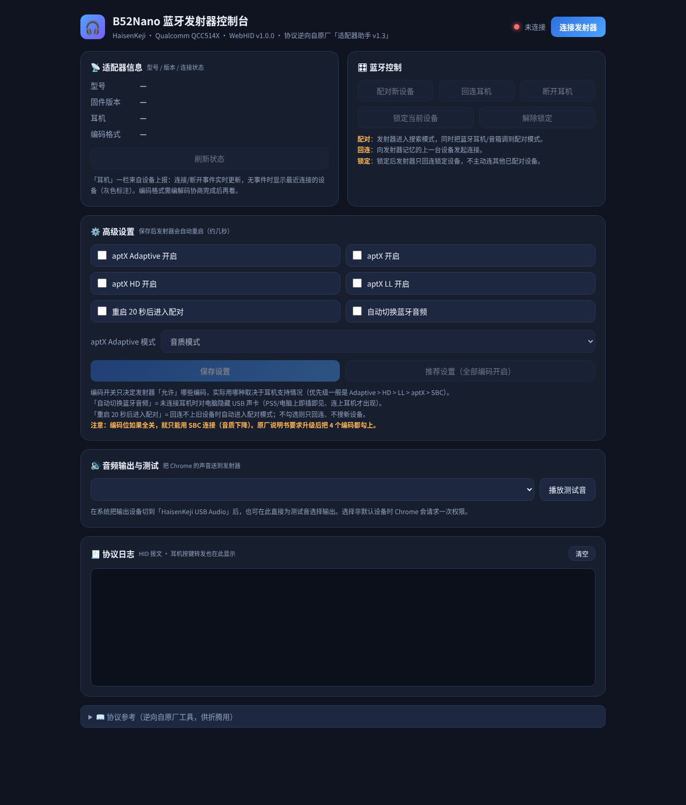

# B52Nano Controller

[](LICENSE)
[](https://developer.chrome.com/docs/capabilities/web-hid)
[](CHANGELOG.md)
[](docs/protocol.md)

**HaisenKeji（海森科技）B52Nano USB 蓝牙音频发射器的浏览器控制台** —— 基于 WebHID 的原厂 Windows 软件
（「B52Nano 设置工具 / 适配器助手 v1.3」）跨平台替代品。单文件、零依赖、无需安装。

<p align="center"></p>

## 这是什么设备？

B52Nano 是一款 Qualcomm QCC514X 方案的 USB 蓝牙音频发射器：插上电脑就是一个 USB 声卡
（UAC 1.0，48 kHz 立体声输出 + 16 kHz 单声道回传），音频经蓝牙以 aptX 系列编码发给耳机/音箱。
对系统而言它只是一块声卡，配对、回连、编码选择等操作原本依赖厂商的 Windows 工具——
本项目的目标就是把这套控制能力搬进浏览器，**Windows / Linux / macOS 通用**。

## 功能

- **蓝牙控制** — 配对新设备 / 回连上一台 / 断开 / 锁定·解锁设备
- **适配器信息** — 型号、固件版本、耳机连接状态（含 MAC）、当前编码实时显示（5 s 轮询 + 事件推送）
- **高级设置** — aptX / aptX HD / aptX LL / aptX Adaptive 编码开关、aptX Adaptive 音质⇄低延时模式、
  自动切换蓝牙音频（未连耳机时隐藏声卡）、重启 20 秒后自动配对
- **一键推荐设置** — 全部编码开启（修复「出厂只开 SBC」的常见坑，见 FAQ）
- **音频测试** — 枚举输出设备、把测试音直接路由到发射器（左右声道交替）
- **协议日志** — 实时 HID 报文收发、耳机多媒体按键转发解码
- **无头自测** — 打开 `?selftest` 自动断言帧构造与应答解析，便于 CI / 回归

## 快速开始

```bash
git clone https://github.com/lazysaltyfish/B52NanoController.git
cd B52NanoController
python3 serve.py          # 打开 http://127.0.0.1:8765
```

或直接用 Chrome / Edge 打开 `index.html`（`file://` 同样支持 WebHID）。

浏览器要求：桌面版 **Chrome / Edge / Opera**（Firefox 不支持 WebHID）。

### Linux 权限（一次性配置）

普通用户需要能读写发射器的 hidraw 设备。创建
`/etc/udev/rules.d/99-b52nano-haisen.rules`：

```
SUBSYSTEM=="hidraw", ATTRS{idVendor}=="0a12", ATTRS{idProduct}=="123b", MODE="0666", TAG+="uaccess"
```

然后执行：

```bash
sudo udevadm control --reload && sudo udevadm trigger
```

Windows / macOS 无需任何配置。

## 使用说明

| 操作 | 说明 |
|---|---|
| **连接发射器** | 首次点击会弹出浏览器授权框，选中 HaisenKeji 设备即可；之后可自动重连 |
| **配对新设备** | 发射器进入搜索模式，同时把耳机/音箱调到配对模式 |
| **回连耳机** | 向发射器记忆的上一台设备发起连接 |
| **保存设置** | ⚠️ 发射器会自动重启几秒，期间声卡消失再出现属正常现象 |
| **改完编码开关后** | 编码在**建链时**协商，改设置后需断开并回连（或重启耳机）才生效 |

## FAQ

**为什么显示的编码是 SBC，但我耳机支持 aptX Adaptive？**
编码开关（bit0–bit3）决定发射器「允许」哪些编码。出厂或升级后可能只有 SBC 开启
（原厂说明书也要求升级后手动勾满 4 个编码）。点「推荐设置（全部编码开启）」保存，
然后断开并回连耳机即可协商到更高编码。

**FastStream 是什么？为什么会显示它？**
FastStream 是 aptX 家族的全双工编码（下行音乐 + 上行语音回传），用于通话/开黑场景，
本机编码索引表中它是一个正常条目。纯听歌时应显示 SBC / aptX 系；若开着语音类应用，
设备切换到 FastStream 属正常行为。注意：本项目早期版本编码表错位一位（把 SBC 显示成
FastStream），v1.0.0 已修正——索引表为 `0=空 1=SBC 2=FastStream 3=aptX 4=aptX LL 5=aptX HD 6=aptX Adaptive`。

**「编码格式」一直显示 — ？**
编码信息由设备在协商完成后上报；查询指令在部分状态下不回复。连接稳定、开始播放后再刷新。

**保存设置安全吗？**
保存帧逐字节复刻原厂工具的格式，并在真机上验证过（保存 → 重启 → 回读一致）。
「推荐设置」等价于原厂说明书的建议配置。

**能升级固件吗？**
原厂升级工具走独立的 DFU 通道（`HidDfu.dll`），不在本项目范围内。请继续使用原厂升级包。

## 工作原理

发射器的 USB 拓扑 = UAC 1.0 声卡（3 个接口）+ HID 控制接口（报告 ID `0x08`，
vendor usage page `0xFFA0`，64 字节帧）。原厂 Windows 工具即通过 hidapi 收发这个通道。

本项目通过**反编译原厂 .NET 工具**（`dnfile`/`dncil` 解析 IL 与 #US 字符串堆）还原出完整
命令/应答表，并在真实硬件上逐条验证（帧构造、时序、边界行为如「保存即重启」「04/0D 查询在
空闲时不应答」等）。完整协议文档见 **[docs/protocol.md](docs/protocol.md)**。

> 逆向仅用于互操作性目的（用户拥有原厂软件与设备的合法使用权），本项目不包含任何原厂代码。

## 贡献

欢迎 issue / PR：其他 B52 系列设备（如 B52HD）的适配、协议补充、UI 改进。
跑 `?selftest` 页面应全绿后再提交。

## 许可证

[MIT](LICENSE)。与 HaisenKeji / Qualcomm 无关联；aptX、Bluetooth 等商标权利归其所有者。

---

## English Summary

A browser-based (WebHID) control panel for the HaisenKeji **B52Nano** USB Bluetooth audio
transmitter (Qualcomm QCC514X), replacing the vendor's Windows-only tool. Single-file,
zero-dependency, cross-platform (Chrome / Edge / Opera on Windows, Linux & macOS).

Features: pair / reconnect / disconnect / lock, live adapter info (version, headset, codec),
aptX-family codec toggles, aptX Adaptive quality⇄low-latency mode, one-click recommended
settings, audio output routing & channel test, live HID protocol log, and a headless
self-test mode. The vendor protocol was cleanly reverse-engineered from the original
.NET utility and verified on real hardware — full documentation in
[docs/protocol.md](docs/protocol.md). MIT licensed.
